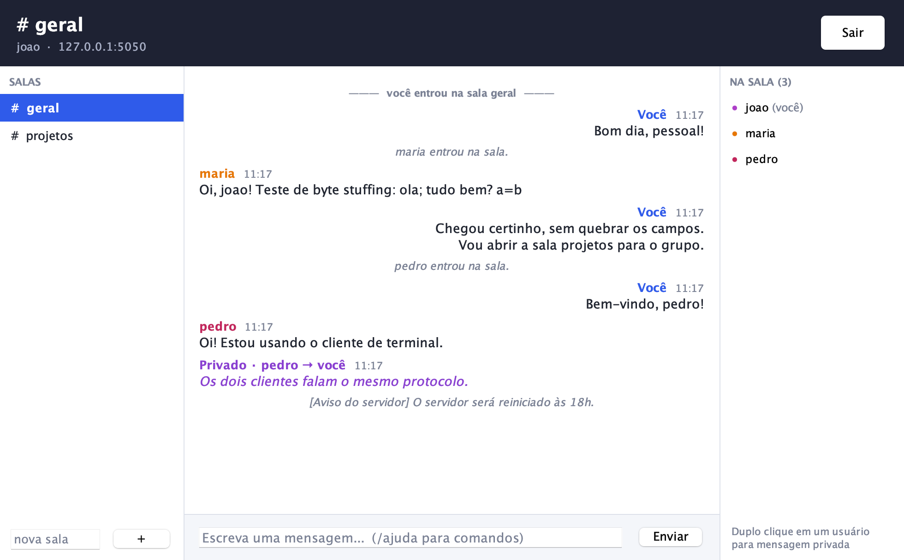

# neon-chat

Chat multiusuário com salas, mensagens privadas, emoticons e envio de arquivos via **sockets TCP** em Java. O projeto tem interface gráfica em Swing com tema neon e também uma versão de terminal. As duas versões usam o mesmo protocolo e conversam entre si.

Projeto da disciplina de **Sistemas Distribuídos**.



## Funcionalidades

- Servidor multithread (uma thread por cliente)
- Salas criadas sob demanda, com histórico guardado no servidor
- Mensagens privadas entre usuários
- Envio de arquivos (Base64, até 5 MB, download sob demanda com pré-visualização de imagens)
- Emoticons por atalho (`:)` → 🙂, `<3` → 💖 …)
- Protocolo textual próprio com *byte stuffing* (`CMD=MSG;TEXT=...`)
- Painel do servidor com log, usuários, salas e envio de avisos

## Requisitos

JDK 17 ou superior (testado com OpenJDK 21). A interface usa apenas Swing, que já vem no JDK.

## Compilar e executar

```bash
javac -encoding UTF-8 -d bin src/*.java
```

**Versão gráfica**

```bash
java -cp bin ChatApp            # tela inicial
java -cp bin ChatApp servidor   # direto no painel do servidor
java -cp bin ChatApp cliente    # direto na tela de conexão
```

**Versão terminal**

```bash
java -cp bin Servidor 5050
java -cp bin Cliente 127.0.0.1 5050
```

> A porta padrão é 5050. No macOS, evite a 5000, que é usada pelo Receptor AirPlay.

## Comandos do cliente

| Comando | Descrição |
|---|---|
| `/login <apelido>` | identifica-se no servidor (terminal) |
| `/join <sala>` | entra na sala (cria se não existir) |
| `/users` | lista os usuários da sala atual |
| `/salas` | lista as salas ativas |
| `/hist <n>` | últimas n mensagens da sala |
| `/msg <apelido> <texto>` | mensagem privada |
| `/arquivo [apelido]` | envia arquivo para a sala ou em privado |
| `/baixar <id>` | baixa um arquivo (terminal) |
| `/emojis` | lista os atalhos de emoticons |
| `/sair` | encerra a sessão |

## Protocolo

Cada mensagem ocupa uma linha, com pares `CAMPO=valor` separados por `;`. Os caracteres reservados são tratados por *byte stuffing*.

```
Cliente → servidor   CMD=LOGIN;USER=joao
                     CMD=JOIN;ROOM=geral
                     CMD=MSG;TEXT=olá
                     CMD=PRIV;TO=maria;TEXT=oi
Servidor → cliente   CMD=OK;INFO=...
                     CMD=MSG;FROM=joao;TS=14:02;TEXT=olá
                     CMD=ERR;COD=02;INFO=apelido em uso
```

A especificação completa (comandos, respostas e códigos de erro) está em [`src/LEIAME.txt`](src/LEIAME.txt). Os diagramas de arquitetura e de sequência estão no [relatório](docs/relatorio.pdf).

## Estrutura

```
src/
  Protocolo.java          codificação das mensagens (byte stuffing)
  Servidor.java           aceita conexões
  ThreadCliente.java      atendimento de cada cliente
  Sala.java               participantes + histórico
  Arquivo.java            arquivos guardados no servidor (Base64)
  Emoticons.java          atalhos de emoticons
  Cliente.java            cliente de terminal
  ThreadRecebimento.java  escuta do socket no cliente de terminal
  ChatApp.java            tela inicial
  TelaServidor.java       painel do servidor
  TelaConexao.java        tela de login
  TelaChat.java           tela de chat
  Estilo.java             tema neon e componentes visuais
docs/
  imagens/                capturas de tela e diagramas
  relatorio.pdf           relatório do projeto
```
